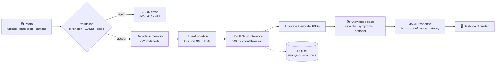
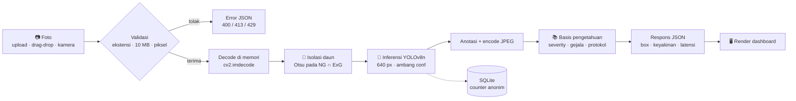

<div align="center">

**🌐 [🇬🇧 English](#-english-version) · [🇮🇩 Bahasa Indonesia](#-versi-bahasa-indonesia)**

</div>

---

# ☕ Coffee Leaf Disease Detection

**Point a phone at a coffee leaf. Get a diagnosis, the lesions, and what to do next — in about 20 ms.**

[](https://www.python.org/)
[](https://flask.palletsprojects.com/)
[](https://docs.ultralytics.com/)
[](https://opencv.org/)
[](Dockerfile)
[](https://github.com/glen1599/coffee-leaf-disease-yolov8/actions/workflows/ci.yml)
[](tests/)
[](#model-metrics)
[](LICENSE)

</div>

<p align="center">
  
  <br>
  <em>The landing page — kinetic type, a real before/after slider, and the detector below the fold.</em>
</p>

<!-- 📸 DROP-IN SLOT: replace the image above with your own hero screenshot or a 10-second
     screen recording. A GIF of a leaf being dragged in and diagnosed does more work than
     any paragraph here. Recommended: 1440×900, under 5 MB. -->

---

## 🇬🇧 English Version

### Why this exists

Coffee is one of Indonesia's biggest agricultural exports, and leaf disease is one of the
fastest ways to lose a harvest. The problem isn't that nobody can spot it — it's that
spotting it *early* needs someone who knows what they're looking at, on site, before the
infection spreads to the next block.

I built this as my thesis project at Universitas Sanata Dharma, but I deliberately didn't
stop at the notebook stage. A model that only lives in Colab helps nobody standing in a
coffee field with a phone. So the last half of the work was the unglamorous part: a Flask
service that loads once, validates input, refuses to fall over on a malformed upload, and
returns something a human can act on.

The result is four classes, per-lesion bounding boxes, a confidence score, and a treatment
protocol — in a single HTTP request, with no file ever touching the disk.

### What it actually does

| | Feature | Why it matters |
|---|---------|----------------|
| 🎯 | **Four-class detection** — Healthy, Phoma Leaf Spot, Coffee Leaf Rust, Leaf Miner | The four conditions that account for most field diagnoses in the dataset |
| 📦 | **Per-lesion bounding boxes** | You see *where*, not just *what* — useful when only one corner is infected |
| ✂️ | **OpenCV auto-crop** | Isolates the leaf from a cluttered background before inference, so a photo of a leaf on a table works as well as a studio shot |
| ⚡ | **ONNX or PyTorch, same API** | The ONNX export drops the torch dependency from the request path when you need a smaller deploy |
| 🧠 | **In-memory pipeline** | `cv2.imdecode` straight from the request buffer — no temp files, no cleanup, no path handling to get wrong |
| 📸 | **Camera + upload + batch** | Single image, up to 8 at once, or a live frame from the browser camera |
| 🛡️ | **Hardened by default** | CSP with no inline script, `X-Frame-Options: DENY`, per-IP rate limiting, 40 MP decompression-bomb guard |
| 📊 | **Anonymous scan log** | Class + latency counters in SQLite for the dashboard. No images, no IPs, nothing identifying |
| ♿ | **Accessible UI** | Reduced-motion, reduced-transparency, keyboard-operable compare slider, `aria-live` results |

### How it works



**The preprocessing step is the interesting bit.** Two independent green indices are built
from the BGR channels — *normalised green* `G / (R+G+B)` and *excess green* `2G − R − B` — each
stretched to full `uint8`, thresholded with Otsu, then intersected. Intersecting two indices
is what makes the mask survive changing light where a single fixed HSV range would fail.
Morphological closing/opening cleans it up, the largest contour is taken, and anything under
3 % of the frame is treated as noise so you get the original image back rather than a crop
of a shadow.

> [!NOTE]
> The model never sees the cropped image — detection runs on the full frame. The crop is a
> *display* artefact, so you can see what the leaf-isolation step actually found.

### Model metrics

YOLOv8n fine-tuned for **50 epochs** at **640 px**, trained on the *Coffee Leaf v5* dataset
from Roboflow (3,992 images, CC BY 4.0).

| Metric | Score | What it tells you |
|--------|-------|-------------------|
| Precision | **96.99 %** | When it says disease, it's rarely wrong |
| Recall | **96.59 %** | It rarely misses a lesion that's there |
| F1 | **96.79 %** | Balanced — not trading one for the other |
| mAP@50 | **98.49 %** | Strong class-and-location agreement |
| mAP@50-95 | **76.32 %** | ⚠️ **Boxes are loose** — see Limitations |

<p align="center">
  
</p>

> [!WARNING]
> That 22-point gap between mAP@50 and mAP@50-95 is the honest headline of this project. The
> model almost always finds the right lesion in the right region, but its rectangles are
> wider than the lesion itself. Treat them as *"look here"*, not as a measured area. I'd
> rather put that on the front page than let someone discover it after trusting the boxes.

### Tech stack

| Layer | Choice | Why |
|-------|--------|-----|
| Detection | **YOLOv8n** (Ultralytics) | Small enough to run on CPU, fast enough for a live demo |
| Runtime | **ONNX Runtime** / PyTorch | Same call site either way; ONNX is the route to a torch-free deploy |
| Vision | **OpenCV** | Decode, green-mask crop, annotation |
| Backend | **Flask 3** | App factory + one blueprint; small enough to read in a sitting |
| Storage | **SQLite** (stdlib) | Anonymous counters and rate-limit windows, no extra service |
| Frontend | Vanilla **HTML/CSS/JS** | No build step, no framework tax for a single page |
| Serving | **Gunicorn** / **Docker** | CPU-only torch image, healthcheck included |

### Project structure

```
coffee-leaf-disease-yolov8/
├── app.py                     # entrypoint: python app.py
├── coffee_leaf/               # application package
│   ├── __init__.py            #   factory, asset versioning, hardening
│   ├── config.py              #   settings + disease knowledge base
│   ├── routes.py              #   HTTP layer + validation
│   ├── detector.py            #   YOLOv8 / ONNX inference service
│   ├── preprocess.py          #   OpenCV auto-crop
│   ├── store.py               #   SQLite scan log + rate limits
│   └── ratelimit.py           #   limiter decorator
├── models/best.pt             # fine-tuned checkpoint (5.9 MB)
├── templates/index.html       # single-page dashboard
├── static/{css,js,img}/       # design system, controller, assets
├── scripts/                   # export_cases.py · benchmark.py
├── tests/                     # 31 tests, no model file needed
├── docs/{MODEL_CARD.md,screenshots,training}
├── Dockerfile · .env.example · pyproject.toml
└── requirements.txt
```

### Getting started

**Requires Python 3.10+.** Verified on 3.11.

```bash
git clone https://github.com/glen1599/coffee-leaf-disease-yolov8.git
cd coffee-leaf-disease-yolov8
```

<details open>
<summary><b>With uv (fastest)</b></summary>

```bash
uv venv --python 3.11
uv pip install -r requirements.txt
uv run python app.py
```
</details>

<details>
<summary><b>With pip</b></summary>

```bash
python -m venv .venv
source .venv/bin/activate        # Windows: .venv\Scripts\activate
pip install -r requirements.txt
python app.py
```
</details>

<details>
<summary><b>With Docker</b></summary>

```bash
docker build -t coffee-leaf .
docker run --rm -p 5000:5000 coffee-leaf
```
</details>

Then open **http://127.0.0.1:5000** and drop a photo in.

> [!TIP]
> On macOS, port 5000 is taken by AirPlay Receiver and will answer your requests with a
> **403** before Flask ever sees them. Start with `PORT=5050 python app.py` and save
> yourself ten minutes of confusion.

### Usage

```bash
# single image
curl -s http://127.0.0.1:5000/predict \
  -F "file=@static/img/samples/coffee_leaf_rust.jpg" \
  -F "conf=0.25"
```

```jsonc
{
  "dominant_class": "karat_daun",
  "severity": "high",
  "total_detections": 26,
  "inference_ms": 19.3,
  "frame": { "width": 2048, "height": 1024 },
  "detections": [
    {
      "label": "karat_daun",
      "label_text": "Coffee Leaf Rust",
      "confidence": 85.34,
      "box": { "x1": 617, "y1": 436, "x2": 760, "y2": 560 }
    }
  ],
  "info": {
    "label": "Coffee Leaf Rust",
    "status": "Pathogen detected",
    "severity": "high",
    "pathogen": "Hemileia vastatrix (fungus)",
    "summary": "Aggressive rust infection…",
    "symptoms": ["Yellow-orange powdery pustules…"],
    "treatment": ["Apply a systemic triazole fungicide…"]
  },
  "annotated_image": "data:image/jpeg;base64,…",
  "original_image": "data:image/jpeg;base64,…",
  "cropped_image": "data:image/jpeg;base64,…"
}
```

**Endpoints**

| Method | Path | Body | Returns |
|--------|------|------|---------|
| `GET` | `/` | — | Dashboard |
| `GET` | `/health` | — | Version, weights, runtime, classes |
| `GET` | `/api/stats` | — | Anonymous aggregate counters |
| `POST` | `/predict` | `multipart`: `file`, optional `conf` | Detection payload |
| `POST` | `/predict/batch` | `multipart`: `files[]`, optional `conf` | `{count, items[]}` |
| `POST` | `/predict/camera` | JSON `{image: "<data-URI>", conf}` | Detection payload |

Errors always come back as JSON: `400` bad input, `413` too large, `429` rate limited,
`500` inference failure.

### Testing

```bash
pytest -q                 # 31 tests, no checkpoint needed
ruff check . && ruff format --check .
mypy
```

The API tests swap `LeafDetector` for a deterministic fake, so the suite finishes in seconds
without loading a model. All three checks run in CI on every push.

### Limitations

I'd rather you read this than find out the hard way.

1. **Loose boxes.** mAP@50 is 98.49 %, mAP@50-95 is 76.32 %. The rectangles are bigger than
   the lesion.
2. **One dataset.** 3,992 photographs from a single Roboflow collection. Accuracy on other
   cultivars, altitudes or phone cameras is *unknown*, not guaranteed.
3. **Clean validation images.** The split happens before augmentation (1,165 sources → 3,493
   training files, zero overlap), so the metrics are honest — but they describe well-lit
   photos, not a blurry shot taken at dusk in the field.
4. **Not an agronomist.** The protocol text is generic. Confirm with an extension officer
   before spraying anything.

Full intended use and reproduction steps: [`docs/MODEL_CARD.md`](docs/MODEL_CARD.md).

### Roadmap

- [ ] Tiled inference for high-resolution field photos
- [ ] Bahasa Indonesia UI (currently English-only)
- [ ] Export to TFLite for on-device phone inference
- [ ] Calibrate confidence scores so 0.9 means something
- [ ] Grow the dataset beyond one collection

### Screenshots

| Detection result | Class explorer |
|---|---|
|  |  |

<!-- 📸 DROP-IN SLOT: add a third row here — the camera view, and a GIF of the confidence
     slider changing the number of detections. That side-by-side sells the feature in
     three seconds. -->

### License

MIT — see [LICENSE](LICENSE). The dataset is CC BY 4.0 by its original authors.

### Author

**Glen Devit Renaldi** · [@glen1599](https://github.com/glen1599)

---

<div align="center">

# 🇮🇩 Versi Bahasa Indonesia

</div>

## Kenapa proyek ini ada

Kopi itu salah satu komoditas ekspor terbesar Indonesia, dan penyakit daun adalah salah satu
cara tercepat kehilangan panen. Masalahnya bukan karena tidak ada yang bisa mengenali
gejalanya — tapi karena mengenali *sedini mungkin* butuh orang yang tahu apa yang dilihatnya,
langsung di kebun, sebelum infeksinya menyebar ke blok sebelah.

Ini awalnya proyek skripsi saya di Universitas Sanata Dharma, tapi saya sengaja tidak
berhenti di tahap notebook. Model yang cuma hidup di Colab tidak menolong siapa pun yang
berdiri di kebun sambil memegang HP. Jadi separuh terakhir pengerjaannya justru bagian yang
tidak menarik: layanan Flask yang load sekali di awal, memvalidasi input, tidak tumbang saat
ada upload aneh, dan mengembalikan sesuatu yang bisa langsung dipakai.

Hasilnya: empat kelas, kotak per-lesi, skor keyakinan, dan protokol penanganan — dalam satu
request HTTP, tanpa satu file pun menyentuh disk.

## Fitur

| | Fitur | Kenapa penting |
|---|-------|----------------|
| 🎯 | **Deteksi empat kelas** — Sehat, Bercak Phoma, Karat Daun, Pengorok Daun | Empat kondisi yang paling sering muncul di lapangan |
| 📦 | **Bounding box per-lesi** | Kamu lihat *di mana*, bukan cuma *apa* — penting kalau cuma satu sudut yang kena |
| ✂️ | **Auto-crop OpenCV** | Memisahkan daun dari latar yang ramai sebelum inferensi, jadi foto daun di meja sama bagusnya dengan foto studio |
| ⚡ | **ONNX atau PyTorch, API sama** | Ekspor ONNX melepas ketergantungan torch dari jalur request |
| 🧠 | **Pipeline in-memory** | `cv2.imdecode` langsung dari buffer request — tidak ada file temp, tidak ada cleanup |
| 📸 | **Kamera + upload + batch** | Satu gambar, sampai 8 sekaligus, atau frame langsung dari kamera browser |
| 🛡️ | **Aman sejak awal** | CSP tanpa inline script, `X-Frame-Options: DENY`, rate limit per-IP, guard 40 MP |
| 📊 | **Scan log anonim** | Hitungan kelas + latensi di SQLite untuk dashboard. Tanpa gambar, tanpa IP |
| ♿ | **UI aksesibel** | Reduced-motion, reduced-transparency, slider bisa pakai keyboard, hasil `aria-live` |

## Cara kerjanya



**Bagian preprocessing-nya yang menarik.** Dua indeks hijau dibangun dari kanal BGR —
*normalised green* `G / (R+G+B)` dan *excess green* `2G − R − B` — masing-masing direntangkan
ke `uint8` penuh, di-threshold pakai Otsu, lalu diiris. Mengiris dua indeks inilah yang
membuat mask-nya tetap bertahan saat cahaya berubah, di mana satu rentang HSV tetap akan
gagal. Morfologi closing/opening membersihkannya, kontur terbesar diambil, dan area di bawah
3 % frame dianggap noise — jadi kamu dapat gambar aslinya kembali, bukan crop bayangan.

> [!NOTE]
> Model **tidak** melihat hasil crop — deteksi tetap jalan di frame penuh. Crop itu artefak
> tampilan, supaya kamu bisa lihat apa yang sebenarnya ditemukan tahap isolasi daun.

## Metrik model

YOLOv8n di-fine-tune **50 epoch** pada **640 px**, dataset *Coffee Leaf v5* dari Roboflow
(3.992 gambar, CC BY 4.0).

| Metrik | Skor | Artinya |
|--------|------|---------|
| Precision | **96,99 %** | Kalau bilang sakit, jarang salah |
| Recall | **96,59 %** | Jarang melewatkan lesi yang ada |
| F1 | **96,79 %** | Seimbang, tidak mengorbankan salah satu |
| mAP@50 | **98,49 %** | Kesesuaian kelas dan lokasi kuat |
| mAP@50-95 | **76,32 %** | ⚠️ **Kotaknya longgar** — lihat Keterbatasan |

> [!WARNING]
> Selisih 22 poin antara mAP@50 dan mAP@50-95 adalah headline jujur proyek ini. Model hampir
> selalu menemukan lesi yang benar di area yang benar, tapi kotaknya lebih lebar dari
> lesinya. Anggap sebagai *"lihat ke sini"*, bukan sebagai luas terukur. Lebih baik saya
> taruh di halaman depan daripada kamu temukan sendiri setelah mempercayai kotaknya.

## Tech stack

| Lapisan | Pilihan | Alasan |
|---------|---------|--------|
| Deteksi | **YOLOv8n** (Ultralytics) | Cukup kecil untuk CPU, cukup cepat untuk demo langsung |
| Runtime | **ONNX Runtime** / PyTorch | Call site-nya sama; ONNX jalan menuju deploy tanpa torch |
| Vision | **OpenCV** | Decode, crop green-mask, anotasi |
| Backend | **Flask 3** | App factory + satu blueprint; cukup kecil untuk dibaca sekali duduk |
| Storage | **SQLite** (stdlib) | Counter anonim dan window rate-limit, tanpa layanan tambahan |
| Frontend | **HTML/CSS/JS** vanilla | Tanpa build step, tanpa pajak framework untuk satu halaman |
| Serving | **Gunicorn** / **Docker** | Image torch CPU-only, healthcheck ikut |

## Struktur proyek

```
coffee-leaf-disease-yolov8/
├── app.py                     # entrypoint: python app.py
├── coffee_leaf/               # paket aplikasi
│   ├── __init__.py            #   factory, versioning aset, hardening
│   ├── config.py              #   konfigurasi + basis pengetahuan penyakit
│   ├── routes.py              #   lapisan HTTP + validasi
│   ├── detector.py            #   layanan inferensi YOLOv8 / ONNX
│   ├── preprocess.py          #   auto-crop OpenCV
│   ├── store.py               #   scan log SQLite + rate limit
│   └── ratelimit.py           #   dekorator limiter
├── models/best.pt             # checkpoint hasil fine-tune (5,9 MB)
├── templates/index.html       # dashboard satu halaman
├── static/{css,js,img}/       # design system, controller, aset
├── scripts/                   # export_cases.py · benchmark.py
├── tests/                     # 31 test, tanpa perlu file model
├── docs/{MODEL_CARD.md,screenshots,training}
├── Dockerfile · .env.example · pyproject.toml
└── requirements.txt
```

## Instalasi

**Butuh Python 3.10+.** Diuji di 3.11.

```bash
git clone https://github.com/glen1599/coffee-leaf-disease-yolov8.git
cd coffee-leaf-disease-yolov8
```

<details open>
<summary><b>Pakai uv (paling cepat)</b></summary>

```bash
uv venv --python 3.11
uv pip install -r requirements.txt
uv run python app.py
```
</details>

<details>
<summary><b>Pakai pip</b></summary>

```bash
python -m venv .venv
source .venv/bin/activate        # Windows: .venv\Scripts\activate
pip install -r requirements.txt
python app.py
```
</details>

<details>
<summary><b>Pakai Docker</b></summary>

```bash
docker build -t coffee-leaf .
docker run --rm -p 5000:5000 coffee-leaf
```
</details>

Buka **http://127.0.0.1:5000** lalu tarik satu foto ke sana.

> [!TIP]
> Di macOS, port 5000 dipakai AirPlay Receiver dan akan membalas request-mu dengan **403**
> sebelum Flask sempat melihatnya. Jalankan `PORT=5050 python app.py` dan hemat sepuluh
> menit kebingungan.

## Contoh pemakaian

```bash
curl -s http://127.0.0.1:5050/predict \
  -F "file=@static/img/samples/coffee_leaf_rust.jpg" \
  -F "conf=0.25"
```

**Endpoint**

| Method | Path | Body | Mengembalikan |
|--------|------|------|---------------|
| `GET` | `/` | — | Dashboard |
| `GET` | `/health` | — | Versi, bobot, runtime, kelas |
| `GET` | `/api/stats` | — | Agregat counter anonim |
| `POST` | `/predict` | `multipart`: `file`, `conf` opsional | Payload deteksi |
| `POST` | `/predict/batch` | `multipart`: `files[]`, `conf` opsional | `{count, items[]}` |
| `POST` | `/predict/camera` | JSON `{image: "<data-URI>", conf}` | Payload deteksi |

Error selalu JSON: `400` input salah, `413` terlalu besar, `429` kena rate limit,
`500` inferensi gagal.

## Testing

```bash
pytest -q                 # 31 test, tanpa perlu checkpoint
ruff check . && ruff format --check .
mypy
```

Test API mengganti `LeafDetector` dengan fake deterministik, jadi suite selesai dalam
hitungan detik tanpa memuat model. Ketiganya jalan di CI setiap push.

## Keterbatasan

Saya lebih suka kamu baca ini daripada menemukannya sendiri nanti.

1. **Kotak longgar.** mAP@50 98,49 %, mAP@50-95 76,32 %. Kotaknya lebih besar dari lesinya.
2. **Satu dataset.** 3.992 foto dari satu koleksi Roboflow. Akurasi di kultivar, ketinggian,
   atau kamera HP lain **tidak diketahui**, bukan dijamin.
3. **Gambar validasi bersih.** Split dilakukan sebelum augmentasi (1.165 sumber → 3.493 file
   latih, tanpa tumpang tindih), jadi metriknya jujur — tapi menggambarkan foto dengan cahaya
   bagus, bukan jepretan blur menjelang gelap di kebun.
4. **Bukan penyuluh pertanian.** Teks protokolnya generik. Konfirmasi ke petugas penyuluhan
   sebelum menyemprot apa pun.

Detail lengkap dan cara reproduksi: [`docs/MODEL_CARD.md`](docs/MODEL_CARD.md).

## Rencana ke depan

- [ ] Tiled inference untuk foto lapangan resolusi tinggi
- [ ] UI Bahasa Indonesia (sekarang masih Inggris)
- [ ] Ekspor TFLite untuk inferensi on-device di HP
- [ ] Kalibrasi skor keyakinan supaya 0,9 benar-benar berarti
- [ ] Perluas dataset di luar satu koleksi

## Lisensi

MIT — lihat [LICENSE](LICENSE). Dataset berlisensi CC BY 4.0 dari penulis aslinya.

## Penulis

**Glen Devit Renaldi** · [@glen1599](https://github.com/glen1599)
