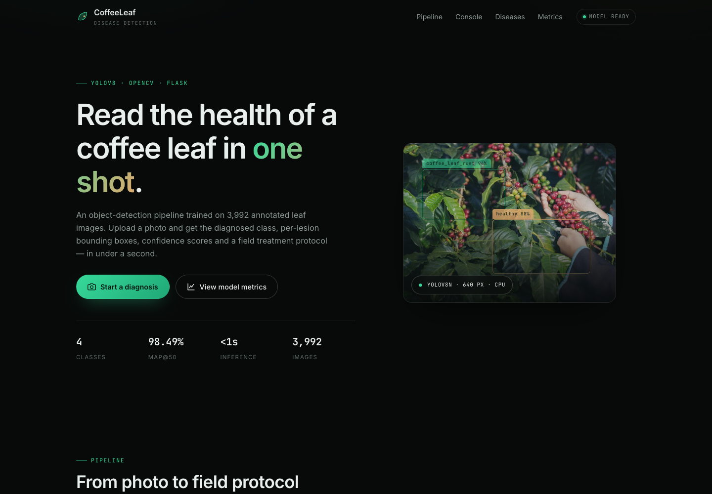
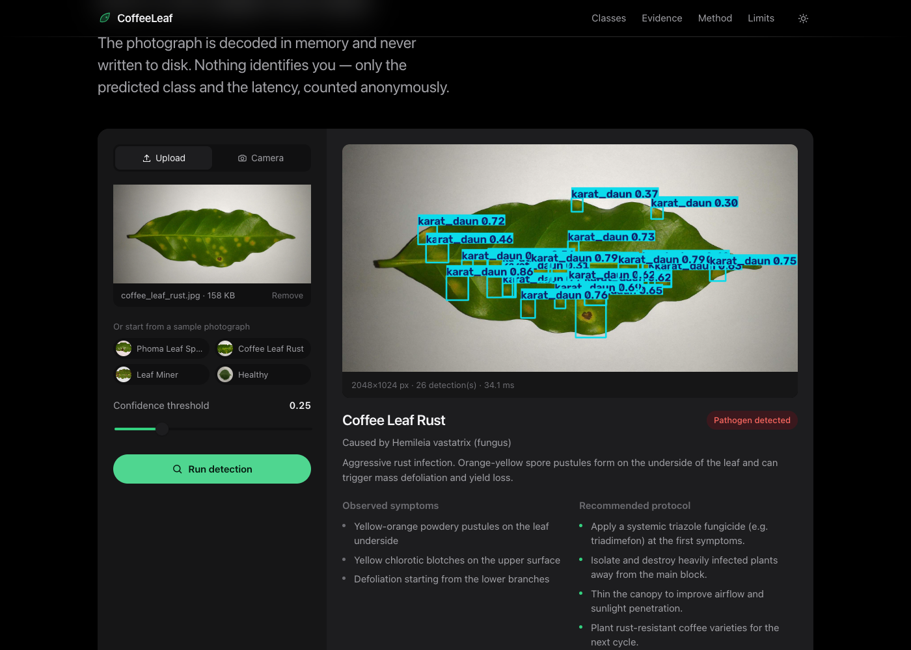
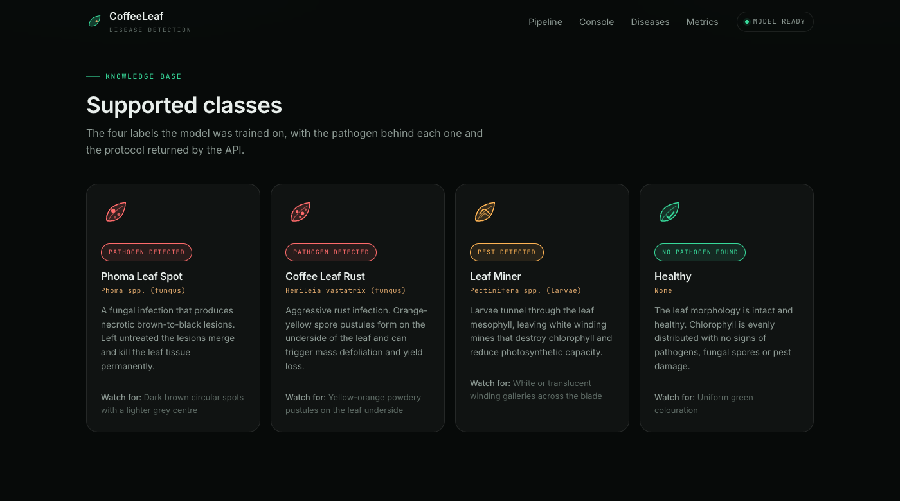
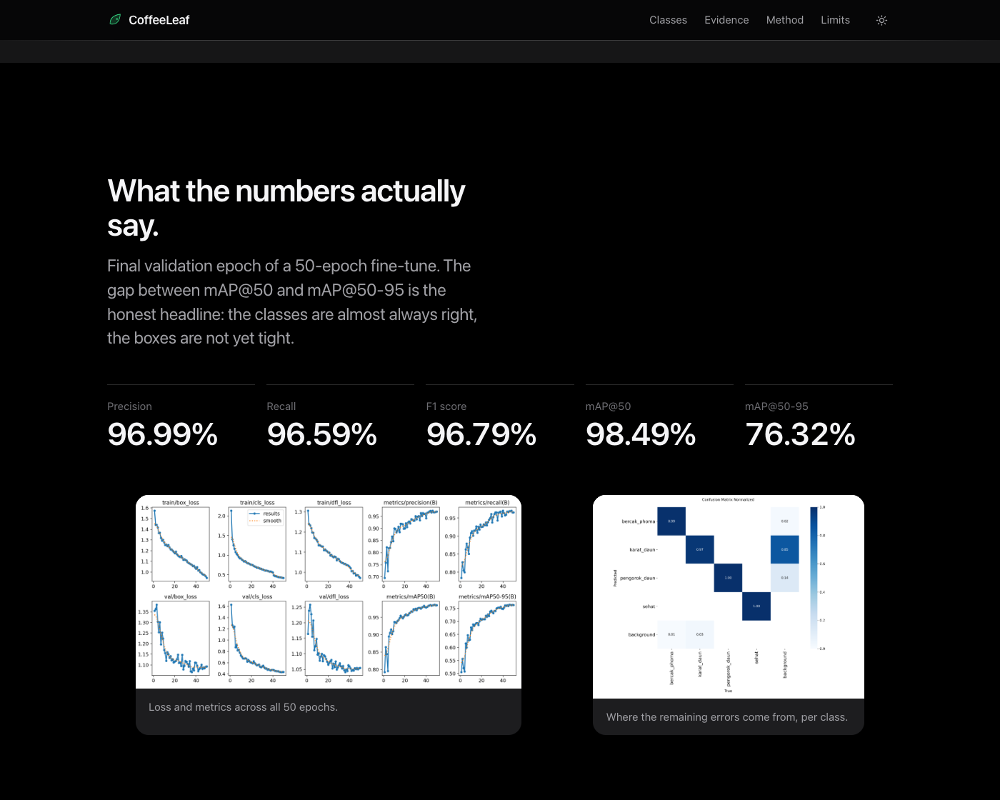
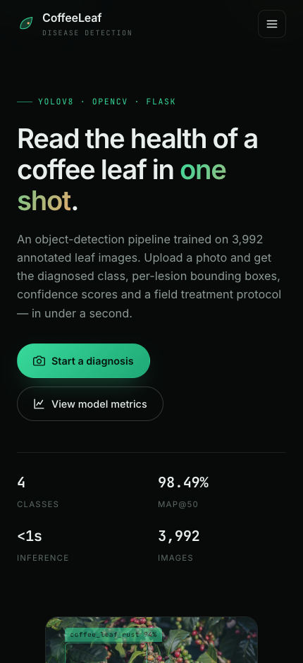
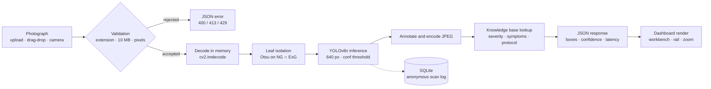
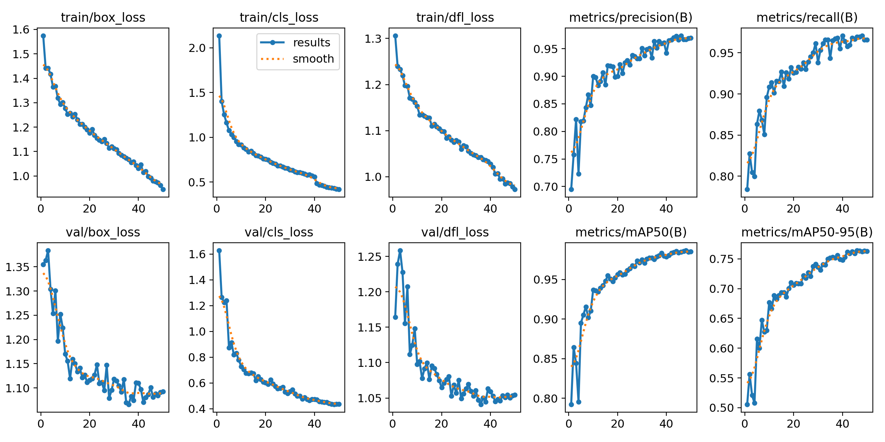
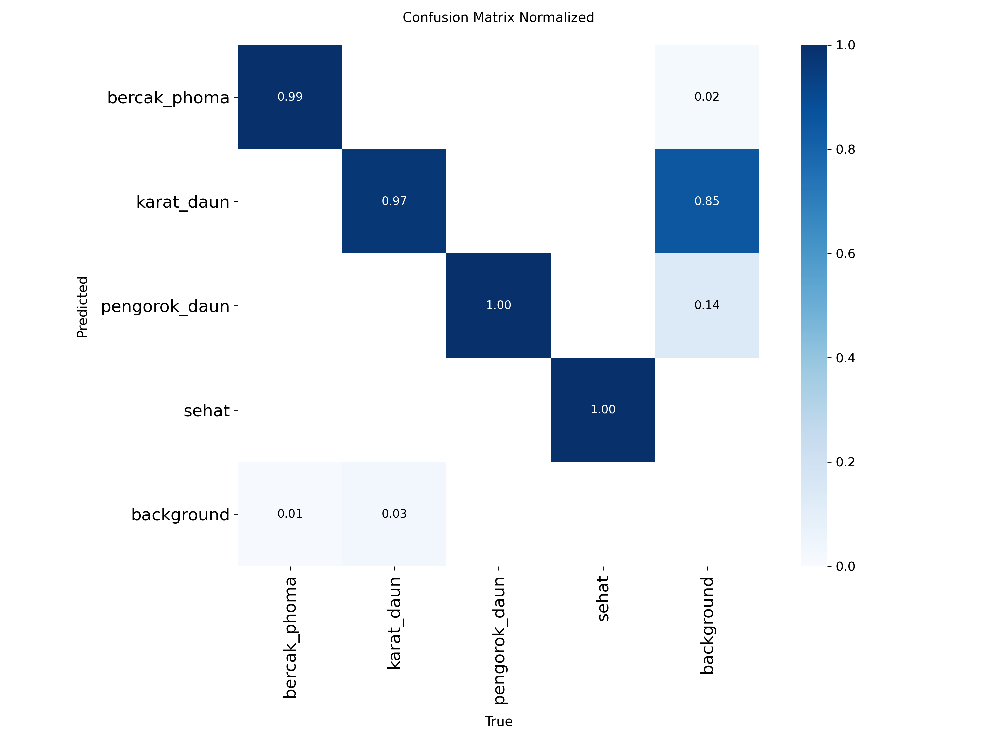
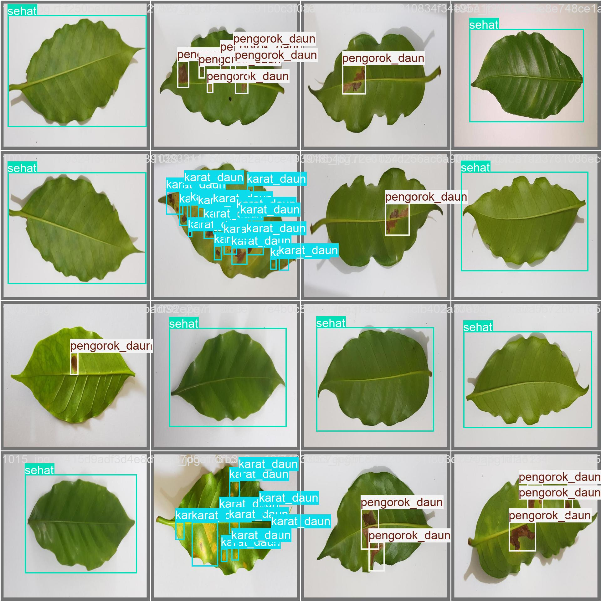
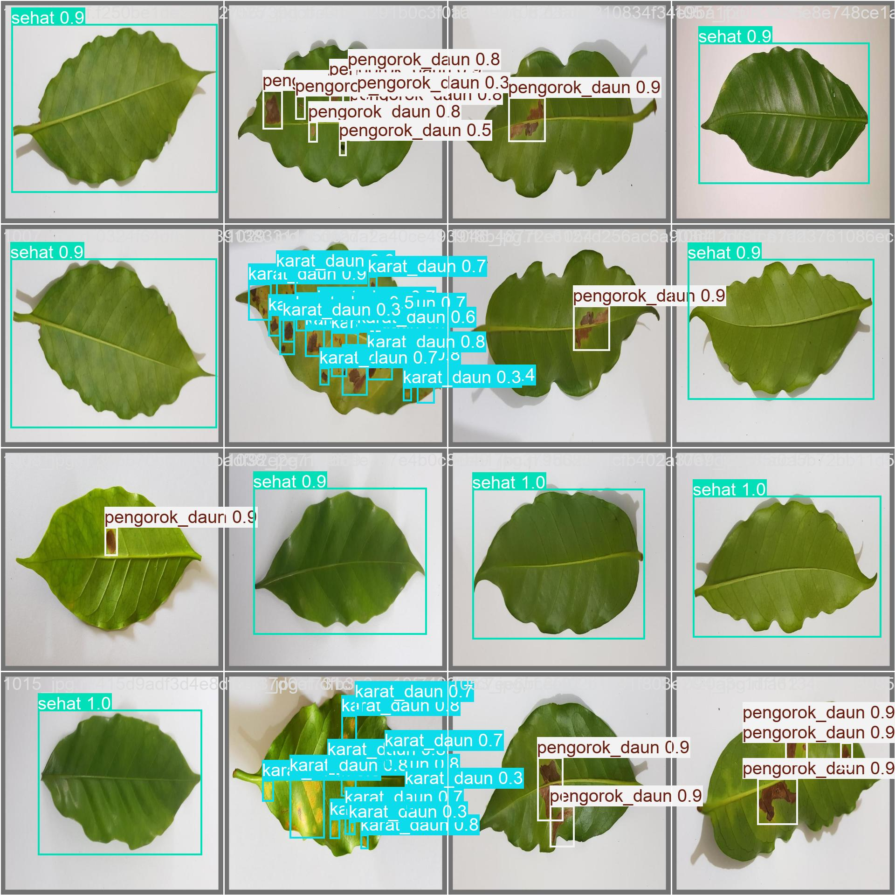

<div align="center">

# Coffee Leaf Disease Detection

**Photograph one coffee leaf. Read the class, the lesions and the field protocol.**

A YOLOv8 detector served by Flask and OpenCV, with an honest model card.

[](https://github.com/glen1599/coffee-leaf-disease-yolov8/actions/workflows/ci.yml)


</div>

---

## Overview

Coffee leaf disease costs yield, and diagnosing it usually needs an agronomist
on site. This project turns a phone photograph into an immediate,
machine-assisted diagnosis: **four classes**, per-lesion bounding boxes,
confidence scores and a treatment protocol.

It is a complete, deployable application rather than a notebook — application
factory, request validation, hardening headers, rate limiting, a scan log,
tests, CI, Docker and a documented model card. The trained weights ship with the
repository, so a fresh clone answers requests in under a minute.

| Class key | Display label | Cause |
| --- | --- | --- |
| `sehat` | Healthy | — |
| `bercak_phoma` | Phoma Leaf Spot | *Phoma* spp. (fungus) |
| `karat_daun` | Coffee Leaf Rust | *Hemileia vastatrix* (fungus) |
| `pengorok_daun` | Leaf Miner | *Pectinifera* spp. (larvae) |

> Class keys live inside the checkpoint and stay in the dataset's original
> language; only display labels are translated. See
> [`coffee_leaf/config.py`](coffee_leaf/config.py).

## Screenshots

| Landing | Detection result |
| --- | --- |
|  |  |

| Class explorer | Validation evidence |
| --- | --- |
|  |  |

<p align="center">
  
  <br><em>Light and dark themes, one responsive layout.</em>
</p>

## Key Features

**Detection**

- End-to-end pipeline: decode → Otsu green-mask leaf isolation → YOLOv8 → annotation, in one request.
- **Batch mode** — up to 8 photographs per request, with a per-file result list.
- **Camera capture** straight from the device, or drag-and-drop upload with live preview.
- Adjustable confidence threshold, clamped server-side between 0.05 and 0.95.
- Annotated image, auto-cropped leaf, per-detection confidence bars, dominant class, latency and protocol.

**Engineering**

- Application factory + blueprint; inference, pre-processing, routing, storage and rate limiting are separate modules.
- **Images are never written to disk** — decoded from a byte buffer, so there is no temp-path coupling and nothing to clean up.
- **ONNX or PyTorch** behind the same interface. `models/best.onnx` is loaded automatically when present; it measured no faster, so it is kept as the route to a torch-free deployment rather than as an optimisation (see `scripts/benchmark.py`).
- Input validation, JSON error responses, structured logging, per-IP rate limiting (SQLite-backed, so it survives restarts), `/health` probe.
- Hardening headers on every response: CSP with no inline script, `X-Frame-Options: DENY`, `nosniff`, `Referrer-Policy`, `Permissions-Policy`.
- Content-versioned assets, so a deploy busts the one-week static cache.
- Decompression-bomb guard: OpenCV refuses images above 40 MP.

**Front end**

- Zero dependencies, no build step. Native `<dialog>`-free, `prefers-reduced-motion` / `-transparency` / `-contrast` all handled.
- Spring motion generated from a damped-oscillator curve rather than hand-picked easings.
- Keyboard-operable compare slider (`role="slider"` + arrow keys), skip link, `aria-live` result region, labelled controls.
- Light and dark themes, system-preference first with a persisted manual override.

**Quality**

- 31 tests covering the API contract, the auto-crop maths, rate limiting and config invariants.
- `ruff` (lint + format) and `mypy` clean; all three run in CI.

## System Architecture & Preprocessing Pipeline



**1 — Input.** Three entry points feed one pipeline: `POST /predict` (one file),
`POST /predict/batch` (up to 8), `POST /predict/camera` (a base64 frame).

**2 — Validation.** The extension is checked against an allow-list, the body
against `MAX_CONTENT_LENGTH`, and the request against a per-IP sliding window
before any pixel is touched. OpenCV itself refuses images above
`MAX_IMAGE_PIXELS` (40 MP), which is the decompression-bomb guard.

**3 — Decoding.** Bytes go straight into `cv2.imdecode` from a `numpy` buffer.
Nothing is written to disk, so there is no temp-file cleanup and no path
handling to get wrong.

**4 — Preprocessing (leaf isolation).** Two independent green indices are built
from the BGR channels — *normalised green* `G / (R+G+B)` and *excess green*
`2G − R − B` — each stretched to the full `uint8` range, thresholded with
Otsu's method and then intersected. Intersecting two indices is what makes the
mask survive changing light where a fixed HSV range would not. Morphological
closing/opening removes speckle, the largest external contour is taken, and a
region under 3 % of the frame is treated as noise and the original image is
returned. The result is the tight crop shipped with every response.

**5 — Detection.** YOLOv8n runs at 640 px and returns boxes, class indices and
confidences. The highest-confidence detection across the frame becomes the
verdict; every box is kept for the table.

**6 — Post-processing.** Boxes are drawn and the frame is JPEG-encoded to a data
URI at `JPEG_QUALITY`. The verdict is joined against the knowledge base in
`coffee_leaf/config.py`, which supplies severity, pathogen, symptoms and the
treatment protocol.

**7 — Presentation.** The JSON goes back to the dashboard, which renders the
annotated frame, the verdict, the per-detection confidence meter and the
protocol — and keeps the last scans in the browser rail.

## Tech Stack

| Layer | Technology | Role |
| --- | --- | --- |
| Model | Ultralytics **YOLOv8n** | Object detection, 4 classes |
| Runtime | **ONNX Runtime** / PyTorch | Inference backend |
| Vision | **OpenCV** | Decode, Otsu auto-crop, annotation |
| Numerics | **NumPy** | Array handling, green-index maths |
| Backend | **Flask** 3 | HTTP API + Jinja templating |
| Storage | **SQLite** (stdlib) | Anonymous scan log, rate-limit windows |
| Front end | Vanilla **HTML / CSS / JS** | Dashboard, drag-and-drop, camera, themes |
| Serving | **Gunicorn** | Production WSGI server |

## Quick Start

Requires **Python 3.10+** (tested on 3.11).

```bash
git clone https://github.com/YOUR-USERNAME/coffee-leaf-disease-yolov8.git
cd coffee-leaf-disease-yolov8
```

<details open>
<summary><b>With uv (recommended)</b></summary>

```bash
uv venv --python 3.11
uv pip install -r requirements.txt
uv run python app.py
```

</details>

<details>
<summary><b>With pip</b></summary>

```bash
python -m venv .venv
source .venv/bin/activate        # Windows: .venv\Scripts\activate
pip install -r requirements.txt
python app.py
```

</details>

<details>
<summary><b>With Docker</b></summary>

```bash
docker build -t coffee-leaf .
docker run --rm -p 5000:5000 coffee-leaf
```

The image installs the CPU-only PyTorch build to keep it ~2 GB smaller. The
model and the ONNX export are baked in at build time.

</details>

Open <http://127.0.0.1:5000> and drop a leaf photograph into the console.

> On macOS, port 5000 is taken by AirPlay Receiver. Start with `PORT=5050 python app.py`
> if `curl` returns a 403.

### Production

```bash
gunicorn --workers 1 --timeout 120 "coffee_leaf:create_app()"
```

Keep `--workers 1` while each worker loads its own copy of the model. The
rate limiter is shared through SQLite, so raising the worker count is a memory
decision rather than a correctness one.

### Configuration

Every value has a working default; all are overridable through the environment
(see [`.env.example`](.env.example)).

| Variable | Default | Description |
| --- | --- | --- |
| `HOST` / `PORT` | `127.0.0.1` / `5000` | Bind address |
| `FLASK_DEBUG` | `0` | `1` enables the reloader |
| `MODEL_PATH` | `models/best.pt` | Checkpoint; a sibling `.onnx` wins when present |
| `CONF_THRESHOLD` | `0.25` | Default confidence threshold |
| `MAX_CONTENT_LENGTH` | `10485760` | Upload cap in bytes |
| `MAX_BATCH_FILES` | `8` | Files per batch request |
| `MAX_IMAGE_PIXELS` | `40000000` | Decompression-bomb guard |
| `DATABASE_PATH` | `instance/app.sqlite3` | Scan log + rate-limit store |
| `RATE_LIMIT_MAX` / `RATE_LIMIT_WINDOW` | `30` / `60` | Requests per IP per window |
| `JPEG_QUALITY` | `85` | Encoding quality of returned images |

## API

| Method | Endpoint | Body | Response |
| --- | --- | --- | --- |
| `GET` | `/` | — | Dashboard (HTML) |
| `GET` | `/health` | — | Version, weights, runtime, class list |
| `GET` | `/api/stats` | — | Anonymous aggregate of recorded scans |
| `POST` | `/predict` | `multipart`: `file`, optional `conf` | Detection payload |
| `POST` | `/predict/batch` | `multipart`: `files[]`, optional `conf` | `{count, items[]}` |
| `POST` | `/predict/camera` | JSON: `{image: "<data-URI>", conf}` | Detection payload |

<details>
<summary><b>Example</b></summary>

```bash
curl -s http://127.0.0.1:5000/predict \
  -F "file=@static/img/samples/coffee_leaf_rust.jpg" \
  -F "conf=0.25"
```

```json
{
  "dominant_class": "karat_daun",
  "severity": "high",
  "total_detections": 26,
  "inference_ms": 19.3,
  "frame": { "width": 2048, "height": 1024 },
  "detections": [
    {
      "label": "karat_daun",
      "label_text": "Coffee Leaf Rust",
      "confidence": 85.34,
      "box": { "x1": 617, "y1": 436, "x2": 760, "y2": 560 }
    }
  ],
  "info": {
    "label": "Coffee Leaf Rust",
    "status": "Pathogen detected",
    "severity": "high",
    "pathogen": "Hemileia vastatrix (fungus)",
    "summary": "…",
    "symptoms": ["…"],
    "treatment": ["…"]
  },
  "annotated_image": "data:image/jpeg;base64,…",
  "original_image": "data:image/jpeg;base64,…",
  "cropped_image": "data:image/jpeg;base64,…"
}
```

</details>

Errors are always JSON: `400` invalid input, `413` payload too large,
`429` rate limited, `500` inference failure.

## Model Metrics

YOLOv8n fine-tuned for **50 epochs** at **640 px**. Values are the final
validation epoch — see [`docs/training/results.csv`](docs/training/results.csv).

| Precision | Recall | F1 | mAP@50 | mAP@50-95 |
| --- | --- | --- | --- | --- |
| **96.99 %** | **96.59 %** | **96.79 %** | **98.49 %** | **76.32 %** |

Inference, measured with `scripts/benchmark.py` on an Apple-silicon CPU across
the four sample photographs:

| Backend | Model call, mean | p95 |
| --- | --- | --- |
| PyTorch (`best.pt`) | 43.4 ms | 47.7 ms |
| ONNX (`best.onnx`) | 43.6 ms | 51.9 ms |

**ONNX is not faster here** (1.00×): Ultralytics loads both through the same
API, so the export removes neither torch from the dependency list nor any
latency. It is committed as a *route* to a torch-free deployment, and
`models/best.onnx` is git-ignored as a derived artefact:

```bash
yolo export model=models/best.pt format=onnx opset=12 simplify=True
```

Re-run the benchmark before quoting any of these numbers on other hardware.
The first request after a cold boot costs ~0.5 s while ONNX Runtime specialises
its kernels; everything after that is the ~20 ms above.

| Curves | Confusion matrix |
| --- | --- |
|  |  |

| Ground truth batch | Predicted batch |
| --- | --- |
|  |  |

Full intended use, limitations and reproduction steps:
[`docs/MODEL_CARD.md`](docs/MODEL_CARD.md).

## Project Structure

```
coffee-leaf-disease-yolov8/
├── app.py                     # Entrypoint: python app.py
├── coffee_leaf/               # Application package
│   ├── __init__.py            #   application factory, asset versioning, hardening
│   ├── config.py              #   settings + disease knowledge base
│   ├── routes.py              #   HTTP layer: routes and validation
│   ├── detector.py            #   YOLOv8 / ONNX inference service
│   ├── preprocess.py          #   OpenCV leaf auto-crop
│   ├── store.py               #   SQLite scan log + rate-limit windows
│   └── ratelimit.py           #   rate-limit decorator
├── models/
│   └── best.pt                # Fine-tuned checkpoint (best.onnx is git-ignored)
├── templates/index.html       # Single-page dashboard
├── static/
│   ├── css/app.css            #   design system
│   ├── js/{boot,app}.js       #   theme pre-paint + controller
│   ├── img/{cases,samples,training,og.jpg}
│   └── manifest.json
├── scripts/
│   ├── export_cases.py        # Regenerate the published case images
│   └── benchmark.py           # Reproduce the latency table
├── tests/                     # pytest: API, pre-processing, config invariants
├── docs/
│   ├── MODEL_CARD.md
│   ├── screenshots/
│   └── training/              # results.csv + args.yaml
├── datasets/README.md         # Dataset provenance (data not committed)
├── Dockerfile · .dockerignore · .env.example
└── pyproject.toml · requirements.txt · .github/workflows/ci.yml
```

## Testing & Code Quality

```bash
pytest -q                    # 31 tests, no model file required
ruff check . && ruff format --check .
mypy
```

The API tests swap `LeafDetector` for a deterministic fake, so the suite runs in
seconds without loading a checkpoint. CI runs all three checks on every push and
pull request.

## Limitations

A detector that only reports its best number is not something to trust a crop
with. The full list is in the [model card](docs/MODEL_CARD.md); the three that
matter most:

1. **The boxes are loose.** mAP@50 is 98.49 % but mAP@50-95 is 76.32 %. The
   model rarely misses a lesion, yet its rectangles are wider than the lesion.
   Read them as “look here”, not as a measurement.
2. **One dataset, one collection.** 3,992 photographs from a single Roboflow
   collection, validated on clean originals rather than field photos. Accuracy
   on other cultivars, altitudes or phone cameras is unknown.
3. **The split is clean, the field is not.** File-name analysis confirms the
   train/validation split happens before augmentation (1,165 sources → 3,493
   training files; zero overlap), so the metrics are honest — but they describe
   studio-quality images, not blur and harsh light.

## Dataset

*Coffee Leaf — v5*, from Roboflow Universe under **CC BY 4.0**: 3,992 images
across four classes. Not committed — see
[`datasets/README.md`](datasets/README.md) for provenance, class mapping and
retraining instructions.

## License

Code and weights: [MIT](LICENSE). Dataset: CC BY 4.0, by its original authors.

## Author

**Glen Devit Renaldi** — [@glen1599](https://github.com/glen1599)

Machine learning and full-stack engineering. Issues and pull requests are welcome.
