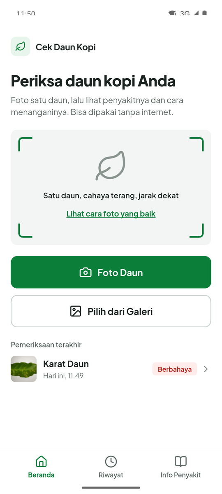
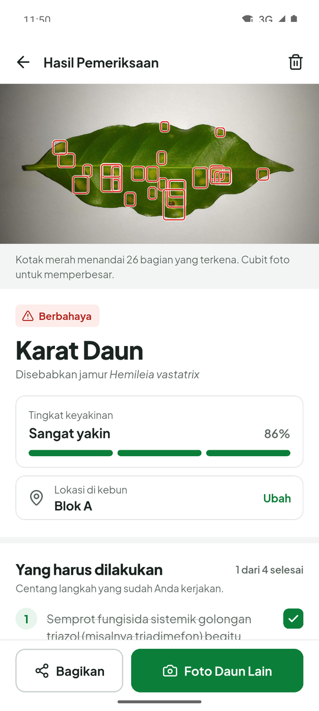
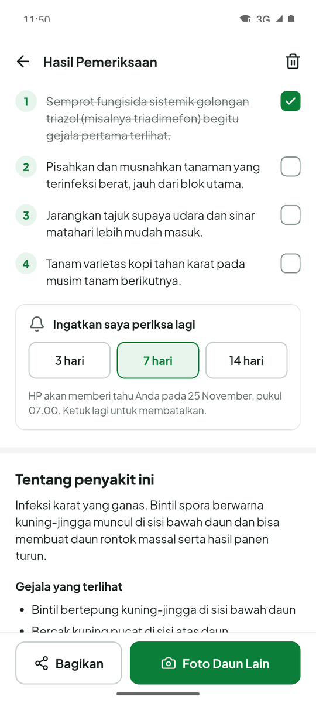
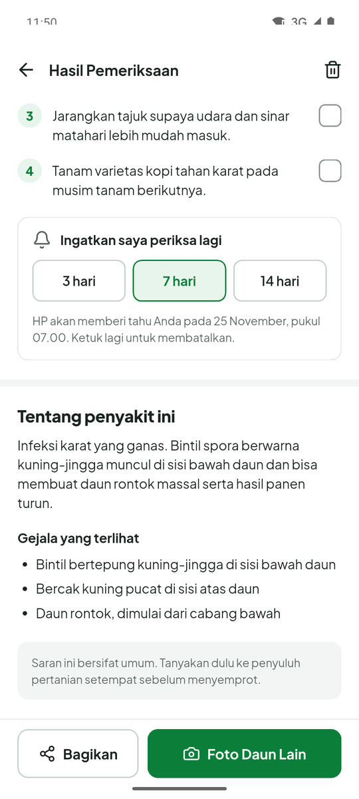
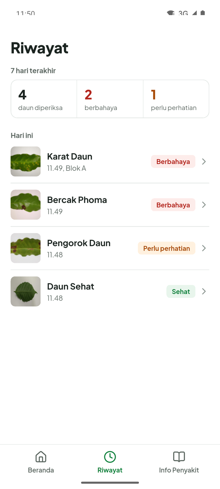
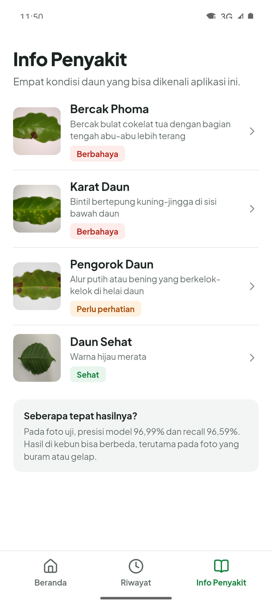
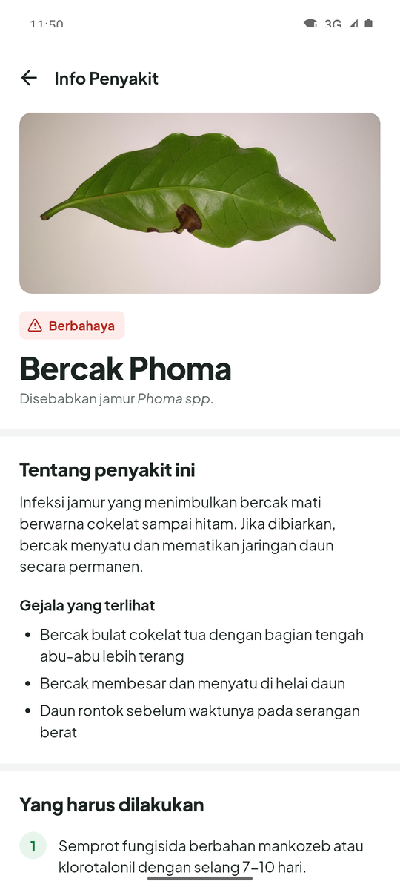
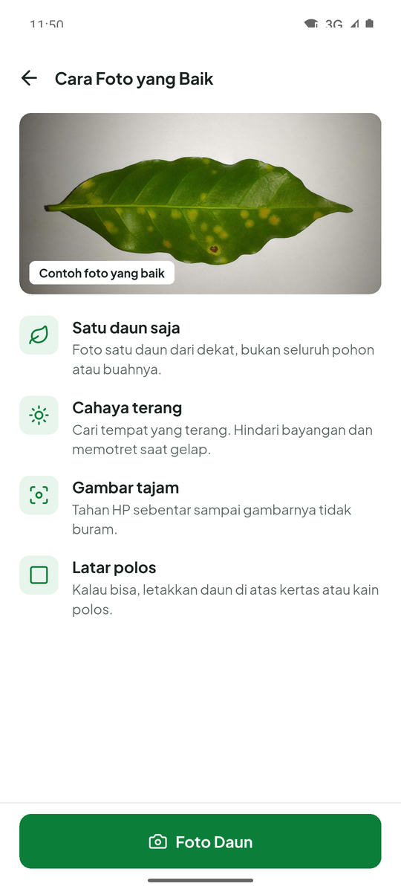

# Cek Daun Kopi

Aplikasi Android dan iOS untuk memeriksa penyakit daun kopi dari satu foto,
**langsung di HP, tanpa internet**. Dibuat dengan Flutter untuk petani UMKM
Kopi Merapi Tunggak Semi, Yogyakarta.

- **Unduh APK Android:** [halaman rilis](https://github.com/glen1599/coffee-leaf-disease-yolov8/releases/tag/mobile-v1.0.0)
  (`app-arm64-v8a-release.apk`, 60 MB, untuk hampir semua HP Android sejak 2017)
- **API dan demo web:** <https://glendevit.pythonanywhere.com>
- **Kode server dan model:** [README utama](../README.md)

| Beranda | Hasil | Langkah dan pengingat | Tentang penyakit |
|---|---|---|---|
|  |  |  |  |
| **Riwayat** | **Info Penyakit** | **Detail penyakit** | **Cara foto yang baik** |
|  |  |  |  |

Semua screenshot diambil dari APK release di emulator Android 16.

---

## Latar belakang

Versi web proyek ini sudah bisa mengenali karat daun, bercak phoma, dan
pengorok daun dari foto. Di kebun, ada tiga masalah dengan versi web:

1. **Sinyal.** Kebun kopi di lereng Merapi sering tanpa sinyal. Aplikasi yang
   butuh internet untuk memeriksa satu daun tidak bisa dipakai di tempat yang
   paling membutuhkannya.
2. **Bahasa.** Versi web berbahasa Inggris dan memakai istilah seperti
   "confidence 0.86". Petani butuh "Sangat yakin" dan langkah yang harus
   dikerjakan.
3. **Tindak lanjut.** Diagnosis hanya awal. Petani perlu ingat blok mana yang
   sakit, langkah mana yang sudah dikerjakan, dan kapan harus memeriksa lagi.

Aplikasi ini menjawab ketiganya: model berjalan di HP, semua teks memakai
Bahasa Indonesia sederhana, dan setiap pemeriksaan menjadi catatan yang bisa
ditindaklanjuti.

## Fitur

| Fitur | Untuk apa |
|---|---|
| **Foto Daun / Pilih dari Galeri** | Dua tombol besar di Beranda, mudah dijangkau dengan satu ibu jari |
| **Deteksi di HP, tanpa internet** | Model YOLOv8 dijalankan ONNX Runtime di perangkat; foto tidak dikirim ke mana pun |
| **Hasil yang langsung bisa dipakai** | Foto dengan kotak di setiap bagian yang terkena, nama penyakit, status (Sehat / Perlu perhatian / Berbahaya), dan tingkat keyakinan dalam kata-kata |
| **Checklist penanganan** | Langkah-langkah dari basis pengetahuan bisa dicentang satu per satu dan tersimpan |
| **Lokasi di kebun** | Catat blok asal daun ("Blok A"); nama yang pernah dipakai muncul sebagai pilihan cepat |
| **Pengingat periksa ulang** | 3, 7, atau 14 hari lagi, pukul 07.00, lewat notifikasi HP |
| **Riwayat dan ringkasan 7 hari** | Semua pemeriksaan tersimpan di HP, dikelompokkan per hari, dengan jumlah daun berbahaya dan perlu perhatian |
| **Bagikan hasil** | Foto dan ringkasan teks lewat lembar bagikan HP, misalnya ke penyuluh lewat WhatsApp |
| **Info Penyakit** | Gejala, penyebab, dan cara penanganan setiap kondisi, dengan foto contoh |
| **Cara foto yang baik** | Empat kebiasaan yang menentukan apakah pemeriksaan berhasil |
| **Pesan yang jelas** | Daun tidak terlihat, kamera belum diizinkan, foto rusak: masing-masing dengan langkah keluarnya |

Teks penyakit dan penanganan **tidak dikarang**: diambil dari basis
pengetahuan di kode server (`coffee_leaf/config.py`) dan diterjemahkan apa
adanya (`coffee_leaf/content.py`). Sebuah tes memastikan terjemahannya tidak
menambah atau mengurangi langkah.

## Cara kerjanya

```
foto ─► putar sesuai EXIF ─► letterbox 640×640 ─► ONNX Runtime (best.onnx)
                                                        │
                       hasil ◄─ kotak di foto asli ◄─ decode + NMS per kelas
```

Ultralytics (pustaka yang dipakai server) tidak bisa berjalan di HP. Jadi tiga
langkah di sekitar model ditulis ulang dalam Dart murni
(`lib/domain/detection/`): letterbox, pembacaan keluaran mentah
`[1, 8, 8400]`, dan non-maximum suppression per kelas. Kesamaan hasilnya
diuji tiga lapis:

1. **Alur acuan NumPy vs server Ultralytics**, pada keempat foto contoh:
   selisih kotak 0 piksel, selisih keyakinan 0,00
   (`scripts/export_mobile_fixtures.py`).
2. **Kode Dart vs keluaran model yang direkam:** tes unit mereproduksi
   ke-26 temuan karat daun persis.
3. **Foto yang disiapkan oleh Dart, dijalankan di model asli:**

   | Foto | Temuan (server / Dart) | Keyakinan teratas (server → Dart) |
   |---|---|---|
   | Bercak phoma | 2 / 2 | 89,92 → 90,04 |
   | Karat daun | 26 / 26 | 86,30 → 86,39 |
   | Pengorok daun | 7 / 7 | 93,94 → 93,94 |
   | Daun sehat | 1 / 1 | 96,16 → 96,15 |

   Selisih kecil berasal dari pembaca JPEG yang berbeda (Dart vs OpenCV).

Di emulator Android, APK release memberi hasil yang sama: Karat Daun 86% dengan
26 tanda, Daun Sehat 96%.

Server ([`/api/v1`](../README.md)) tidak dipakai untuk mendeteksi. Saat ada
internet, aplikasi hanya mengambil teks Info Penyakit terbaru dan memakainya
mulai pembukaan berikutnya.

## Teknologi

| Bagian | Pilihan | Alasan |
|---|---|---|
| Kerangka | Flutter 3.50 (Dart 3.14) | Satu kode untuk Android dan iOS |
| Model | YOLOv8n diekspor ke ONNX, `flutter_onnxruntime` | Model yang sama dengan server, tanpa konversi ulang |
| Gambar | `image` (Dart murni), di isolate terpisah | Dekode dan rotasi EXIF tanpa membuat layar tersendat |
| Penyimpanan | File JSON + JPG di folder aplikasi | Cukup untuk riwayat satu HP; tanpa basis data |
| Kamera, galeri | `image_picker` | Kamera dan pemilih foto bawaan sistem |
| Pengingat | `flutter_local_notifications` | Notifikasi terjadwal di HP sendiri, tanpa server |
| Bagikan | `share_plus` | Lembar bagikan bawaan (WhatsApp, SMS, ...) |
| Huruf | Plus Jakarta Sans, dibundel | Tampilan sama tanpa internet |
| Ikon | Lucide (garis luar) | Satu gaya ikon yang konsisten |

## Arsitektur

Pola berlapis dengan MVVM di lapisan tampilan. Setiap lapisan hanya mengenal
lapisan di bawahnya.

```
lib/
├── domain/                  Model data dan logika murni, tanpa Flutter
│   ├── models/              Disease, ScanResult, HistoryEntry, ContentBundle, ...
│   └── detection/           letterbox, preprocess, decode + NMS (port dari Ultralytics)
├── data/
│   ├── services/            Pintu ke dunia luar: ONNX Runtime, kamera, notifikasi,
│   │                        bagikan, pengaturan HP, HTTP
│   └── repositories/        Deteksi, riwayat (file di HP), konten (aset + API)
├── ui/
│   ├── core/                Tema (warna, huruf), format tanggal Indonesia, widget bersama
│   ├── features/            Satu folder per layar: views/ + view_models/
│   ├── app_scope.dart       Wadah dependensi; tes menggantinya dengan versi palsu
│   └── navigation.dart      Alur antarlayar di satu tempat
├── config/app_config.dart   Alamat API (bisa diganti saat build)
└── main.dart                Merakit semuanya
```

Beberapa keputusan:

- **Native plugin di balik antarmuka.** `ModelRunner`, `PhotoPicker`,
  `ReminderScheduler`, `ResultSharer`, dan `SettingsOpener` adalah antarmuka;
  tes memakai versi palsu, jadi seluruh alur bisa diuji tanpa HP.
- **Model dimuat malas.** Sesi ONNX (12 MB) dibuat setelah layar pertama
  tampil, jadi aplikasi terbuka dalam ±0,3 detik.
- **Tulis aman.** Riwayat ditulis ke file sementara lalu diganti nama, jadi HP
  yang mati di tengah penyimpanan tidak merusak data lama.
- **Konten satu sumber.** `assets/content/diseases.json` dibuat dari kode
  server (`scripts/export_mobile_content.py`); HP dan API tidak mungkin
  berbeda isi.

## Menjalankan

### Kebutuhan

- Flutter 3.50 atau lebih baru
- Android: Android SDK (platform 36 dan 37, NDK 28.2), JDK 17
- iOS: Xcode lengkap dari App Store, iOS 16 ke atas

### Jalankan di emulator atau HP

```bash
cd mobile
```

```bash
flutter pub get
```

```bash
flutter run
```

Aplikasi memakai server publik untuk memperbarui teks. Untuk server lain,
atau untuk mematikannya:

```bash
flutter run --dart-define=API_BASE_URL=http://10.0.2.2:5000
```

```bash
flutter run --dart-define=API_BASE_URL=
```

### Tes

```bash
flutter test
```

114 tes: deteksi (pada keluaran model asli yang direkam), repositori, view
model, dan setiap layar. Tes layar bisa menyimpan gambar setiap halaman,
untuk memeriksa tampilan tanpa HP:

```bash
PREVIEW_DIR=build/previews flutter test test/ui/screens
```

### Build APK

```bash
flutter build apk --release --split-per-abi --target-platform android-arm,android-arm64
```

Hasilnya di `build/app/outputs/flutter-apk/`:

| File | Ukuran | Untuk |
|---|---|---|
| `app-arm64-v8a-release.apk` | 60 MB | HP Android 64-bit (hampir semua HP sejak 2017) |
| `app-armeabi-v7a-release.apk` | 50 MB | HP Android lama 32-bit |

APK ditandatangani dengan kunci di `android/key.properties`, yang tidak masuk
git. Tanpa file itu, build release memakai kunci debug supaya clone baru tetap
bisa di-build. Cara membuat kuncinya:
<https://docs.flutter.dev/deployment/android#sign-the-app>.

### iOS

```bash
flutter build ios --simulator
```

Untuk iPhone sendiri tanpa akun Apple Developer berbayar: buka
`ios/Runner.xcworkspace` di Xcode, pilih target **Runner** → **Signing &
Capabilities** → **Team**: Apple ID pribadi Anda, ganti **Bundle Identifier**
dengan yang unik, lalu jalankan ke iPhone yang tersambung kabel. Aplikasi
yang dipasang dengan Apple ID gratis berlaku 7 hari, lalu perlu dipasang
ulang dari Xcode.

## Memasang APK di HP Android

1. Unduh `app-arm64-v8a-release.apk` dari
   [halaman rilis](https://github.com/glen1599/coffee-leaf-disease-yolov8/releases/tag/mobile-v1.0.0)
   di HP.
2. Buka file yang terunduh. Kalau HP bertanya, izinkan pemasangan dari sumber
   ini (Chrome atau Files).
3. Ketuk **Pasang**.

Kalau muncul pesan "Aplikasi tidak kompatibel", HP itu 32-bit: pakai
`app-armeabi-v7a-release.apk`.

## Keterbatasan

1. **Model tidak mengenal "bukan daun".** Model hanya punya empat kelas daun.
   Foto yang sama sekali bukan daun kopi tetap bisa diberi nama penyakit;
   kamera emulator yang memotret gambar rumah dinilai "Pengorok Daun". Jika
   tidak ada temuan sama sekali, aplikasi menampilkan "Daun kopi tidak
   terlihat", tetapi itu tidak menangkap semua kasus.
2. **Keyakinan belum dikalibrasi.** Batas "Sangat yakin" (≥85%) dan "Cukup
   yakin" (≥60%) adalah batas tampilan, bukan peluang yang sudah dikalibrasi.
3. **Saran bersifat umum.** Teks penanganan berasal dari basis pengetahuan
   proyek; aplikasi selalu mengingatkan untuk bertanya ke penyuluh pertanian
   sebelum menyemprot.
4. **Belum diuji di iPhone.** iOS sudah disiapkan (target iOS 16, ikon,
   izin kamera), tetapi belum dijalankan di Simulator maupun iPhone.
5. **Satu dataset.** Akurasi model di kebun lain atau kamera HP lain belum
   diketahui; lihat [`docs/MODEL_CARD.md`](../docs/MODEL_CARD.md).

## Lisensi

- Kode: MIT, lihat [LICENSE](../LICENSE).
- Plus Jakarta Sans: SIL Open Font License 1.1 ([`assets/fonts/OFL.txt`](assets/fonts/OFL.txt)).
- Ikon Lucide: ISC.
- Model dilatih dengan Ultralytics YOLOv8 (AGPL-3.0).

---

## In short (English)

**Cek Daun Kopi** is a Flutter app (Android and iOS) that diagnoses coffee leaf
disease from one photo, entirely on the phone. The YOLOv8n model runs through
ONNX Runtime; letterboxing, output decoding and class-aware NMS were ported
from Ultralytics to pure Dart and checked against the Python server on real
photos (same findings, top confidence within 0.12 points). The interface is in
plain Indonesian for smallholder farmers and turns each check into a record
they can act on: a treatment checklist, the garden block, a re-check reminder,
a seven-day summary and sharing with an extension officer. Layered
architecture with MVVM, platform plugins behind interfaces, 114 tests
including every screen. The Flask API is optional and only refreshes the
disease text when a connection is available.
